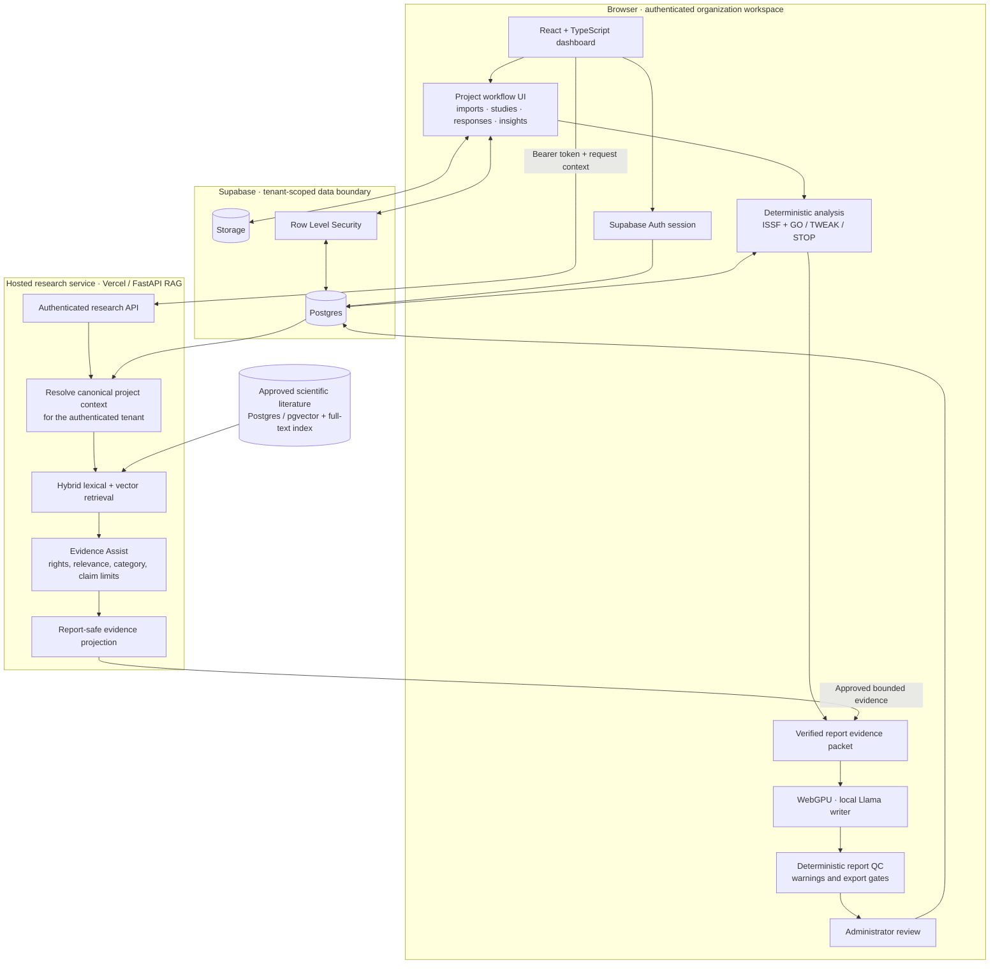

# Architecture

This diagram describes the intended production request path from the repository's
current implementation and operational documentation. It distinguishes the
browser-local report writer from the hosted research service.

## Request and trust boundaries

1. **Identity and tenancy.** The browser sends its Supabase access token to the
   research API. The service validates the token and derives tenant and role
   from authenticated claims; browser-supplied project context is a lookup hint,
   not proof that a record belongs to the caller.
2. **Canonical evidence.** The service resolves project, sample, decision,
   food type, and ISSF against tenant-scoped database records before marking
   product-specific evidence as verified.
3. **Literature eligibility.** Retrieval is followed by deterministic checks
   for approval status, usage rights, relevance, category fit, duplicate or
   unsafe material, and permitted claims. Unknown or disallowed material fails
   closed.
4. **One-way projection.** Internal retrieval records are projected into a
   restricted report-safe schema. Raw chunks, paths, titles, excerpts, backend
   identifiers, and retrieval scores are not passed to the local report writer.
5. **Local report writing.** The browser runs the WebGPU-backed Llama model.
   Report prose is generated from the bounded packet rather than sent to a
   hosted language-model provider. Deterministic QC and administrator approval
   remain release gates.
6. **Deterministic decisions.** Numerical scoring, workflow gates, authorization,
   and evidence-contract validation remain ordinary code, not LLM decisions.

## Demo path

Use the synthetic accounts and sample-data notes in
[`DEMO_INSTRUCTIONS.md`](../DEMO_INSTRUCTIONS.md). A concise walkthrough is:

1. Open the Insights workspace and compare a product's panel evidence.
2. Open Decision Review and explain the ISSF score, threshold, confidence, and
   evidence behind the recommendation.
3. Follow a confirmed GO decision into concept validation.
4. Open the literature library to show approval and usage-rights controls.
5. Open the report workflow to explain the report-safe packet, local writer,
   QC findings, and administrator review boundary.

The diagram documents the architecture; it is not a claim that this repository
has undergone an independent security audit or that every external deployment
configuration has been verified.
